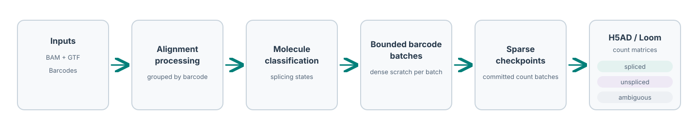

  

<h1 align="center">Scindere</h1>

<strong>Resource-aware RNA splicing quantification for single-cell transcriptomics.</strong>

  
  
  
  
  

Scindere counts spliced, unspliced and ambiguous molecules from single-cell and
single-nucleus BAM alignments with a genome-matched GTF. It supports RNA velocity
analysis but does not infer velocity; molecule classification follows velocyto.

  

## Capabilities

- **Memory-aware processing:** bounds counting batches while keeping each barcode group intact.
- **Recoverable execution:** resumes validated checkpoints and exports completed runs without source alignments.
- **Efficient storage:** commits compressed sparse count shards and streams them to output.
- **Platform flexibility:** generic BAM, 10x Genomics, BD Rhapsody, DropEst and Smart-seq2 workflows.
- **Interoperability:** H5AD or Loom output with separate spliced, unspliced and ambiguous layers.
- **HPC readiness:** Slurm and Apptainer examples, telemetry and scheduler-aware sorting controls.

The `--count-memory-mb` estimate covers counting components, not total process
RSS; annotation, sorting and output use additional memory.

## Installation

Requires Rust 1.89 or newer and HDF5 development libraries (plus `pkg-config` on
Unix-like build hosts). See the [installation guide](https://thokas99.github.io/scindere/installation.html).

~~~sh
cargo install --locked \
  --git \
  https://github.com/Thokas99/scindere \
  --branch main
scindere --version
~~~

## Quick start

For a BAM with cell barcodes in `CB` and UMIs in `UB`:

~~~sh
scindere run sample.bam genes.gtf \
  --bcfile barcodes.tsv \
  --cb-tag CB --ub-tag UB \
  --sampleid sample \
  --outputfolder results
~~~

The run writes `results/sample.h5ad` and retains a resumable
`results/sample.counts` checkpoint. Find [quick-start, workflow and recovery
guides](https://thokas99.github.io/scindere/).

## Benchmarks

A synthetic 200,000-read case measured 0.112 s median count time versus 0.121 s
for the map-based baseline, with no measurable RSS change. This fixture does not
establish production performance or whole-job memory use; see the
[benchmark methods and results](https://thokas99.github.io/scindere/benchmarks/index.html).

## Citation, credits and license

Scindere carries forward Rust implementation and engineering work from
[velocyto-rs](https://github.com/zqfang/velocyto-rs) and `velocyto-rs-lite`.
The molecule-classification method follows velocyto and La Manno et al.,
[“RNA velocity of single cells”](https://doi.org/10.1038/s41586-018-0414-6);
Scindere does not introduce a new classifier. See [Citation & Credits](https://thokas99.github.io/scindere/citation.html)
and [CITATION.cff](CITATION.cff). Scindere is BSD 2-Clause licensed; preserve
upstream notices when redistributing.
